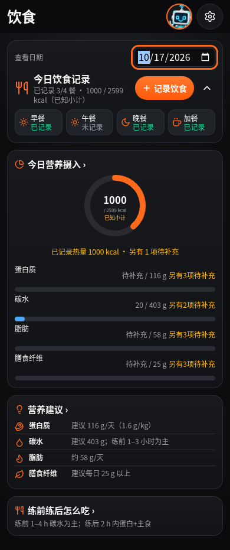
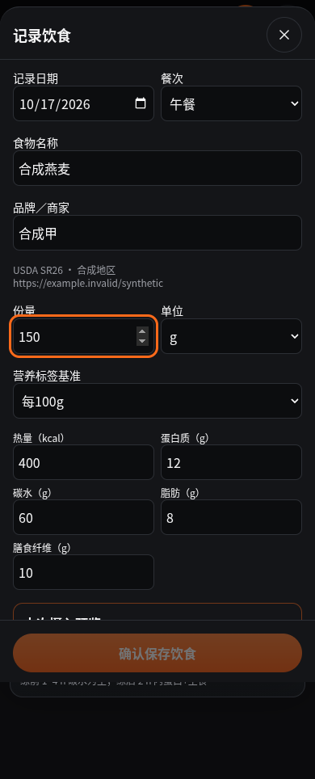

# V74 后续人物替换准备检查点

结论：用户最新要求的“后续替换准备”已完成。新版人物本体和运行时替换尚未完成，不能作为新版视觉正式发布包。保持现有角色展示与教练逻辑；没有部署。

已完成：固定三类角色身份与版本合同、76个力量动作的男女152个待填绑定、严格角色/动作/模型来源对应、加载失败状态、资源哈希缓存接口，以及只读导入检查工具与回退说明。角色、动作、关键帧缺失或未审核不会自动变成可用资源。新播放器接口尚未接入当前页面。

同期饮食修复：品牌/产品明确选择，100g/按份换算，五项营养同条保存，未知保持为空，保存版本与人工修订状态；具体缺项定位，编辑/删除/跨日与刷新联动，保留旧记录和来源。修复了全局样式误隐藏营养明细与缺失提示、输入框触控高度不足、连续修改份量的累计舍入，以及旧碳水别名复活问题。

## 实际测试

| 范围 | PASS | FAIL | SKIP |
| --- | ---: | ---: | ---: |
| npm test | 2366 | 0 | 0 |
| 补充完整源码测试 | 1326 | 0 | 0 |
| 新增只读导入工具合成测试 | 12 | 0 | 0 |
| 开发版 Chromium 饮食流程 | 25 | 0 | 0 |

TypeScript 类型检查、生产构建通过。上表不重复累加早期定向测试。浏览器使用全新合成上下文及合成食物库，覆盖390/430/820宽度、五项计算、品牌隔离、未知、编辑、换餐/跨日、删除、刷新、草稿和原数据保留；没有 POST 请求或未捕获运行时异常。截图已经人工查看。

生产构建下的离线浏览器调用未获得执行结果，记为 NOT_RUN。真实 iPhone、新人物视觉、全部动作质量、正式 GLB 校验、性能与新媒体缓存运行时验收均未执行。12项导入工具测试使用结构合成夹具，绝不代表真实角色已通过。

## 失败与修复记录

- 初次类型检查有2个编译错误（Sheet必需属性及测试类型收窄），已修复，最终类型检查通过。
- 首次开发浏览器冷启动超时：保留失败日志，后续同测试流程完成。
- 两轮浏览器脚本问题：餐次可访问名称与SVG文本读取方式不正确，修正定位/API，没有降低业务断言。
- 浏览器发现真实显示缺陷：历史明细中的数值被全局小字样式隐藏。修复后同一数值断言通过，缺项提示一并恢复。
- 所有原始日志保留；单项/定向成功没有替代整体3D验收。

## 安装与回退

交付 `code` ZIP 是最新候选源码代码分包，`guide` ZIP 含本轮说明、原定稿图、截图和日志。两包解压到同一空目录，再合并原 V74 七个 resources 分包，得到完整独立开发副本。资源分包字节未变，见 required-resource-checksums.json。不能把它当V70的直接安装更新包。

已有完整 V74 八分包基线可作为回退点，存于本检查点同级 rollback 目录。另附小型代码回退包：恢复5个原源码文件、删除本次新增文件即可回到基线；须先备份后续改动，不能覆盖其他版本。回退仅涉及源码，不删除或写回训练、饮食、健康、计划存储。node_modules、构建输出和用户本地数据不进入交付包。

## 后续接入

参见《新版人物替换交接.md》和《资产缺项与视觉标准.md》。先制作并核验实际 GLB 与动作，再迁移播放器和所有入口，最后完成离线及真机检查。旧展示引用清单是审计线索，尚未执行旧人物/线条回退清理。此次未修改 src/lib/core 下文件。

## 实际截图（合成数据）

定稿图片另附，文件名以 approved 开头，属于目标参考，不是本轮已实现人物。
