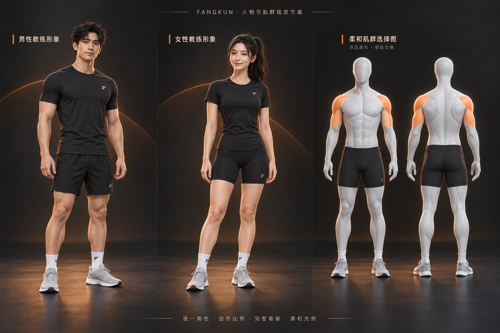
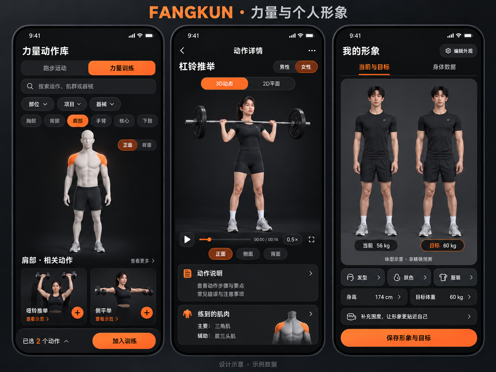

# 视觉制作状态：尚未完成

两张 PNG 是用户批准的目标，不是已实现页面截图，也不是可旋转的模型。本轮不把旧 GLB 改色/改宽或生成图片当作新人物交付。当前独立副本仍使用 V74 展示路径；新版资源开关关闭，未部署。

## 待制作资源

| 资源 | 当前状态 | 最小交付条件 |
| --- | --- | --- |
| 成人男性教练 | BLOCKED_ASSETS | 单独精修脸、头发、手足、黑色上衣和短裤；GLB、贴图、母版、许可、蒙皮及形变范围 |
| 成人女性教练 | BLOCKED_ASSETS | 单独打磨自然比例、面部和马尾；服装适配，不能仅改男性肩髋宽度 |
| 温和肌群模型 | BLOCKED_ASSETS | 哑光浅灰、柔和分区、不透明运动短裤；稳定肌群拾取 ID、臀部衣物表面高亮、足底独立示意 |
| 代表动作 | BLOCKED_ASSETS | 推举、深蹲、硬拉、分腿蹲、划船、提踵的男女版本；核对关节轨迹、支撑、器械接触和穿模 |
| 同角色二维关键帧 | BLOCKED_ASSETS | 每动作 4—6 帧及封面；记录角色、模型 SHA-256、动作剪辑和取样时间 |
| 全动作与热身覆盖 | NOT_RUN | 76 个内置动作逐项审校；热身另列清单，不能沿用数量冒充覆盖 |

## 已做与未做

已检查旧模型结构及运行时引用；Blender 4.3.2 可运行并完成只读导入检查。现有 Three.js 为 r169。本轮没有安装新压缩器、没有下载付费模型、没有得到符合参考图的新模型，也没有完成雕刻、服装和动作精修。结构盘点不等于 Khronos 官方校验、视觉验收或动作审校。

已实现可调用的媒体合同、精确 ID/角色/版本匹配、审核门控、播放状态与资源哈希缓存接口。这些接口当前没有替换旧播放器；接口测试数量以最终日志为准，不能代表新人物通过。

下一阶段先完成上述三类资产和代表动作，视觉达标后再接各页面入口。实际运行时撤掉旧人物及线条回退尚未完成。禁止把这个检查点标为新版视觉发布包。

## 视觉锁定

- 成人自然运动者比例、黑色运动服、真实皮肤和柔和棚光。
- 人物、服装、器械、光照及动作在 3D、二维关键帧与个人画像中一致。
- 当前/目标锁定身份、身高、姿势、相机与脚底基线，只改变经约束的体型示意。
- 实测数据、外观偏好、目标设置分开；缺失体脂或围度不补成真实值。
- 相机限制俯仰与缩放，不翻转、不穿入模型；动作合法离地不锁脚。
- 真实 iPhone Safari、安全区、键盘、帧率和内存尚未验收。

