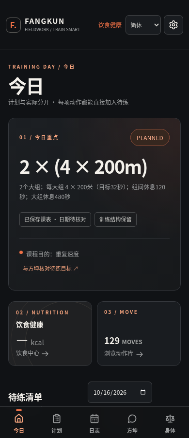
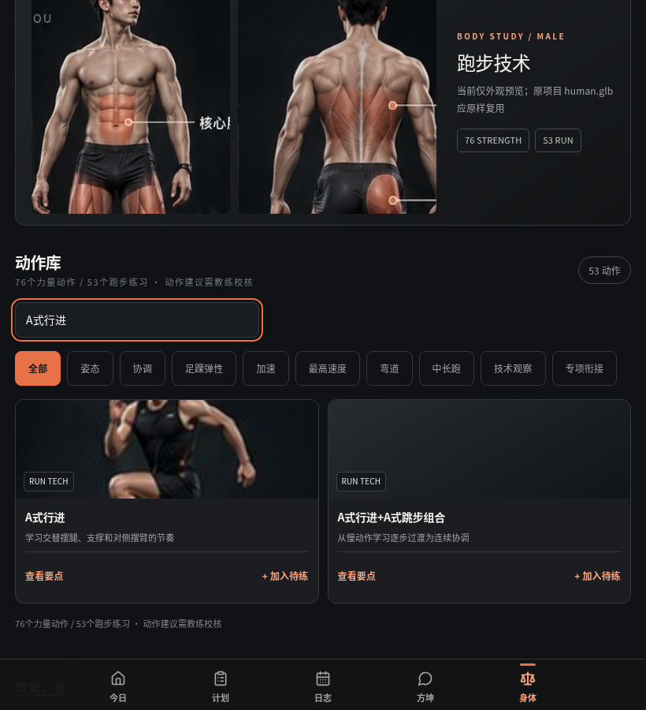
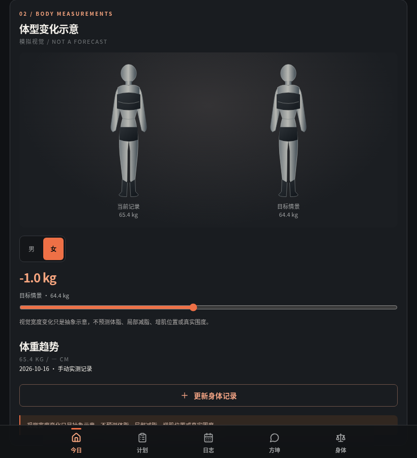
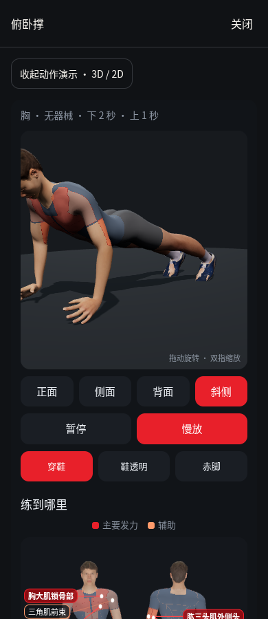
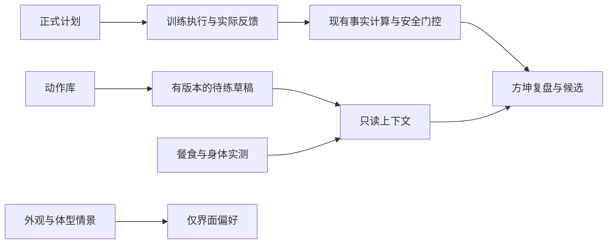

# 方坤 FIELDWORK V4 · Codex 交付说明

本次在独立开发副本完成主页、运动与力量动作入口、饮食与健康页，以及这些页面与现有方坤教练的只读关联。复用原有训练事实、训练结构、规则引擎、医疗安全门控和事件存储，没有创建第二套 AI Brain。未部署，未覆盖正式版本，未调用外部模型，未自动修改正式训练计划。

## 当前界面与人物基准

以下为本次本地浏览器实拍，示例数字均来自合成数据。截图是外观验收参考，真正的页面仍由源码和真实本地记录生成。

## 实际实现

| 模块 | 当前行为 | 与方坤的关系 |
| --- | --- | --- |
| 今日页 | 从现有跑步计划读取课程；保留 `2 × (4 × 200m)`、目标时间、组间与大组休息；未知日期不冒充今日实际 | 查看草稿时先核对目的、适用性和批准状态 |
| 动作库 | 使用现有 53 条跑步技术、76 条力量动作及稳定 ID；可搜索、分类、查看详情、选择日期和训练环节 | 动作只加入待练草稿；不变成已完成事实 |
| 待练草稿 | 新增、编辑、删除均保存版本和历史；同日同环节同动作防重复；保存失败保留输入并明确未保存 | 只作为 CONTEXT 候选供查看；没有计划写入权限 |
| 原人物演示 | 保留 `human.glb`、骨架、motions、四视角、暂停、慢放、鞋模式；显式缓存后支持离线重开 | 动作观察不自动变为力量缺陷或生理诊断 |
| 饮食 | 实际日期、进食时刻、食物、热量；营养素可未知；复用现有事件日志 | 问及本人记录时引用具体数字；不把已记录热量当全天完整摄入 |
| 身体记录 | 实测日期、体重及可选腰围；保留来源与保存时间 | 原始指标供只读核对，不生成未经核准的能力分 |
| 体型情景 | 单独保存外观偏好与视觉情景 | 不进入实测事实、恢复判断或能力图评分 |
| 页面关联 | 饮食/今日 → 方坤预填问题，需主动发送；方坤身体入口 → 恢复工具；旧动作入口 → 新动作库 | 沿用既有本地推理，不发云端请求 |

## 后续 UI 与角色交接约定

后续设计优先替换 `src/components/fieldwork-v4/` 的视图与样式，通过 `fieldwork-panel.tsx` 使用同一适配层。主入口仍是五项导航，饮食是独立子页，恢复工具保留在身体工作区。不要让新设计自行写正式计划或另存一套健康数据。

`fieldwork-host.ts` 是页面读写边界；成功保存必须返回 `{ok:true,state}` 的权威回读结果。草稿引用真实目录 ID、内容版本、审核状态和 revision。未知剂量保持 null；不能从文案补默认处方。草稿与外观偏好按运动员隔离，并纳入现有备份白名单。

真实餐食和实测通过原有 `NUTRITION_RECORDED`、`BODY_MEASUREMENT_RECORDED` 事件保存。旧数据保留；无归属旧记录仅在原 local 范围读取，不随意合并到其他运动员。只读教练上下文检查保存时间及观察日期，不让未来数据进入较早的判断。

## 给 Grok 的外观与部署准备说明

1. 解压完整源码后，以本说明中的截图及 `asset-manifest.json` 为外观基准。不要重新绘制人物、替换骨架或用生成图片代替真实页面。
2. 原始人物路径是 `/demo3d/models/human.glb`，动作在 `/demo3d/motions.js`。保持这些路径、GLB、rig、动作映射和授权文件；不能因为本地路径错误就换一套人物。
3. 保留 `/fieldwork-v4/` 的 19 张参考图及来源；插图不是新增的动作动画。女性目前只有明确标注的二维占位，不能把男性模型悄悄当成女性三维完成品。
4. Node 22，使用原 `package-lock.json`。运行 `npm ci`、`npm run typecheck`、`npm run build`、`npm run verify:fieldwork-assets`。本次未新增依赖。构建时没有 DATABASE_URL 会显示迁移跳过，这是原有本地存储路径，不代表启用了云数据库。
5. GLB 和 JS 要从同源真实静态文件提供，不能被 SPA HTML fallback 吞掉；`viewer3d.js` 的同源完整 URL 是本次加载修复的一部分。保留原 PWA、PreviewHostBridge、平台壳和离线缓存版本。
6. 新版设计或角色资产先进入独立副本，对照 manifest 做明确版本变更；未交接的角色、动作或医学译文保持待审查。

原始 `human.glb` SHA256：`cbf479cf66cb281b96d83b41816b5894e4f9da9833c015821b95499c9440353c`。

原始 `motions.js` SHA256：`adf1be4369953ed288debfc4d099de93ad8891721ef110ffc467f682f68c3251`。

## 实际缺陷与修复

| 缺陷 | 修复与验证位置 |
| --- | --- |
| 原模型可直开，但 App 动态加载被 Vite 添加 import 参数，出现二维降级 | provider 改为同源完整 URL；regions 图使用模块相对地址；播放器浏览器检查记录实际 WebGL 与降级两条路径 |
| 构建版首次模型加载实测约 28 秒，原 10 秒等待提前降级 | 保留即时二维展示，将有上限的冷加载等待改为 45 秒；取消与迟到资源清理继续保留，验收仍要求真正进入 WebGL |
| 只读数据已进入事实包，多轮回答却被通用开场覆盖 | 本地回答显式处理记录核对；保留医疗与既往急症优先级；浏览器核对回答真实包含 321 千卡及 65.4 公斤 |
| 新旧饮食、动作与身体入口不一致 | 统一动作库入口，饮食转独立页，恢复工具保留原工作区；浏览器核对往返 |
| 乐观保存可能使页面与实际状态分离 | 所有页面保存由 host 验证并回读；故障注入验证未保存提示、原输入和原历史保留 |

完整修改文件及 SHA 见 `changed-files.json`。它与本轮回退包比较，代码包中的文档和截图也列入交付清单。

## 验证范围与剩余限制

| 本轮检查 | PASS | FAIL | SKIP | 实际执行方式 |
| --- | ---: | ---: | ---: | --- |
| 相关单元与回归 | 638 | 0 | 0 | 16 个测试文件，逐文件直接执行现有 Node 测试框架，实际退出码均为 0 |
| 构建版页面与只读关联 | 49 | 0 | 0 | 包含离线刷新、真实数字进入回答、保存故障注入 |
| 最终构建版原人物 | 15 | 0 | 0 | 实际 WebGL、四视角、缓存、离线刷新重开、无 WebGL 降级、减少动态效果 |
| 类型检查与构建 | 通过 | 0 | — | 最新源码退出码均为 0 |
| 外观资产完整性 | 50 个文件一致 | 0 | — | 字节数与 SHA256 校验 |

开发版页面 47 项通过；早期开发版播放器另有 14 项通过，最终人物以构建版 15 项为准。浏览器检查数与单元测试数分别列示，不冒充同一种测试。移动与平板截图已人工查看。

实际执行数量、退出码和 PASS/FAIL/SKIP 以同目录 `验收结果.json` 及测试日志包为准；失败前后日志均保留。当前是本轮页面与只读关联的针对性验收，不能称为全项目重新完整回归。

上一核心基线的 2798 项测试及旧核心浏览器结果仅作为历史证据，未叠加成本轮测试数量。没有重跑全部真实 Garmin 资料，没有真实 iOS/Android 设备验收，没有模型测试，也没有部署验证。

六种语言完成界面切换；动作正文以现有中文和英文内容为准，日文、韩文医学与训练专业译文未完成审校。53 个技术动作仍保留待教练审核状态；12 个动作分镜不等于 12 段已交付动画。76 个力量动作的专业动作学核验未因本轮 UI 接入自动完成。

女性三维资产尚未提供。能力图仍执行原标准：可靠原始指标与同协议历史可展示，没有核准常模的维度待评估；本轮没有新增经验 0—100 分。训练剂量、医疗回归与正式计划调整仍需适用条件及相应确认。

本轮可进入下一轮独立集成审阅；不能据本说明直接发布正式版本。

## 回退

本轮修改前完整源码包：`r190-before-fieldwork-v4.zip`；SHA256 `f03fb64353233e6ba048ac0e1a6ffd34b7795db5dada96a10d9c59bad63bf1c7`。另交付紧凑代码回退包，含被改动文件的原版与新增文件清单。回退只恢复代码，不删除用户 localStorage 或已有训练事件。
