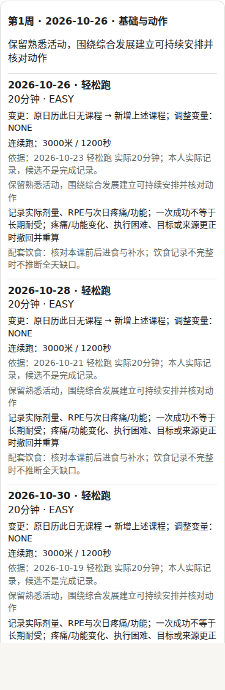
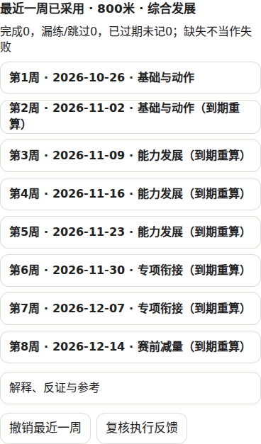

# R6 个体周期教练交付

基线：master `c8053c86cd2b69addeb72949faed0bd558ecac49`（已含 R5）。独立分支 `codex/r6-personal-periodization-20261025`。没有合并、部署或真实模型调用。

## 本次落地

1. **个人画像**：复用既有 90 天事实投影、训练模型及有效资料；区分目标与实测，分来源/设备协议展示成绩、实际跑步与力量、已记周剂量和主观反馈。撤回、未来、外账号或失效的关联训练不能通过日历旧值重新进入画像；同一 occurrence 去重。
2. **个体周期草案**：独立保存有版本的项目、比赛日期、目标成绩、经验、重点及窗口。结合具体训练星期、时间、器材、身体限制和本人实际课程，生成基础、发展、专项、减量阶段。发展/专项阶段优先已有证据支持的关键课；基础阶段优先熟悉低强度。已有课程消耗本周候选预算，关键课相邻日期受保护；V4 未核清剂量不叠加。没有合适实际课程时给目的和条件，不造配速或训练量。
3. **执行反馈与修订**：预览不写日历；只有最近一周可确认，之后各周到期按最新反馈重算。确认复核目标、归属、事实及日历版本；原子回执防重复，未开始且未被后来编辑的课程可撤销。保存接受、拒绝、削弱、撤回历史；较旧已接受版本仍可撤销。实际明显少练、缺记录与无痛均不冒充效果证明。
4. **对照评估与提示词**：安装 `wshobson/agents` 的 `prompt-engineering-patterns` skill（skills 仓库提交 `2a5bf57`）。将版本化的事实边界、竞争解释、反证、确认限制和相关示例接入实际在线请求的事实包；陈旧草案不发送为当前候选。未修改模型权重、未运行付费优化。现有 1000 字上限、鉴权、数字及安全校验继续使用。

同时修复日历写入锁在同步异常后未及时释放的问题；没有更换 UI 框架或原有数据存储，没有清理用户缓存。

## 实际验证

所有数据为合成数据，测试阻止真实联网模型请求。完整回归按 `package.json` 的 `npm test` 顺序拆成 17 组，单组失败仍继续其余组，避免 `&&` 提前终止。

| 验证 | 本轮结果 | 范围 |
|---|---:|---|
| 首轮完整回归（审查修正前） | 3931 通过 / 7 失败 | 17 组；不能称全绿 |
| 最终周期回归 | 49 通过 / 0 失败 | 含 11 个审查反例、确认/撤销、账户、纠错、实际请求包、时钟变化 |
| 最终受影响兼容回归 | 22 通过 / 0 失败 | 在线传输、原日历写入 |
| 最终对照回放 | 18 通过 / 0 失败 | 确定性场景；与单元测试重叠，不相加为能力分 |
| 最终类型检查 | 退出码 0 | `tsc --noEmit` |
| 最终生产构建 | 退出码 0 | `npm run build`；无 DATABASE_URL，迁移按原逻辑跳过 |
| 开发版与构建版页面检查 | 均退出码 0 | 桌面/390px 手机，无横向溢出、控制台错误 0，构建版未偏离开发版 |
| 实际交互 | 6 场景通过、控制台错误 0、模型请求 0 | 目标、预览、确认、撤销、临赛变更、疼痛限制 |

命令、完整回归各组计数、最终测试日志和截图在本目录 `evidence/`。后续审查修改只重跑周期及受影响传输/日历测试、类型和构建，没有将首轮全量计数冒充最终新一轮全量结果。

完整回归中的 5 个代码/断言失败在独立还原的同一 master 源码中复现（40 测试：35 通过、5 失败）：

- `online-facts-v86.test.ts`：仅旧日志仍触发“用户在用的计划”文案。
- `coach-knowledge-display.test.tsx`：知识来源文案与旧断言不一致。
- `hydration.test.tsx`：首屏空状态断言不一致。
- `session-builder.test.tsx`：已有懒加载动作演示与 SSR 断言不一致。
- `recovery-host-u11.test.ts`：旧历史更正/暴露测试失败。

另外 2 项失败为本地未恢复的旧 3D 二进制资源（anatomy-r9、R189）；远端文件仍以原 SHA 完整保留。页面所需的三张既有图片已从同一提交恢复并校验 SHA。以上旧问题未用跳过断言或改测试期望掩盖；PR 保持草稿，不声称正式上线条件已经全满足。

## 六组修改前后对照

| 输入/动作 | 原行为或风险 | 本轮实际结果 |
|---|---|---|
| 保存 800 米、120 秒目标 | 缺少统一版本化周期目标 | 目标第 1 版保存；6 条原实际记录不变；目标不作为成绩 |
| 生成八周草案 | 只有单周安排，缺跨阶段预览 | 展示基础→发展→专项→减量；预览前后日历均 6 条 |
| 确认后撤销 | 缺周期确认闭环 | 仅最近一周新增 3 条，日历 6→9；撤销 9→6；远期写入 0 |
| 比赛由 12 月 20 日改至 11 月 1 日 | 旧周期可能继续适用 | 依据失效，重算首周 BASE→TAPER |
| 新增疼痛 6/10、功能受限 | 设备正常可能混淆安全判断 | 草案进入 hold，不能确认；设备分数不解除限制 |
| 同一实际训练重复关联/历史依据撤回 | 重复计数或旧值重新进入 | 一次训练只计一次；失效关联不作为课程依据；旧结论撤回 |

确认卡展示具体连续跑或轮次×重复结构、休息、力量组次/负重及未知项；显示原日历→候选差异和来源日期。截图为运行中 App，不是设计稿。

## 限制与能力评价

**工程能力**：四项已接入原 App 的可执行闭环；上述自动化和合成浏览器场景通过。现有主线仍有上述失败，iPhone 真机、真实账户并发、真实 Garmin/COROS 账号及生产服务器未在本轮端到端验证；本地账号隔离不代表已新增跨设备云同步。

**专业判断能力**：未做教练盲评、真实运动员纵向效果验证或真实 DeepSeek 推理评测，不能据测试数宣称已达到专业私人教练水平。阶段边界、赛前减量窗口、记录剂量上限都是可复核产品策略，不是个体生理模型；参考综述不意味着个人适用性已经证明。现有安全评估保守，缺信息仍可给低强度条件草案；增量候选必须满足明确的 `NO_ADVERSE_SIGNAL_OBSERVED` 状态，当前真实恢复宿主尚不产出此状态，所以不把合成夹具中的增量通过说成线上已具备自动进阶能力。不会用疼痛=0绕过这一限制。

计划优先复用本人有实际证据的熟悉课程；没有逐段、逐组实际剂量时不给伪精确课。营养仍是现有模块的完整性与配套提示，没有新增经过个人验证的营养处方。后台推送/后台定时、个体最佳周期预测、权重微调不在本轮完成项中。

## 回滚

PR 未合并时关闭 PR 即可，master 不变。以后若人工合并，可 revert 本 PR 的代码提交。用户已经确认写入的课程通过卡片撤销（保护已开始/后来更改记录），不能通过清缓存或删除历史回滚；周期目标与审计日志保留以便追溯。

## 确认卡截图

页面检查保留现有 `BRAND NOTE`：未定制分享卡。测试阻止 Service Worker，因此页面“离线功能暂不可用”不表示已验证 PWA 缓存安装；本轮离线判断指无需模型网络的本地计算。
