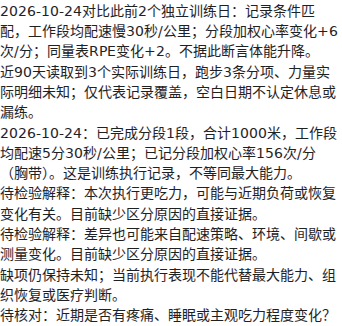
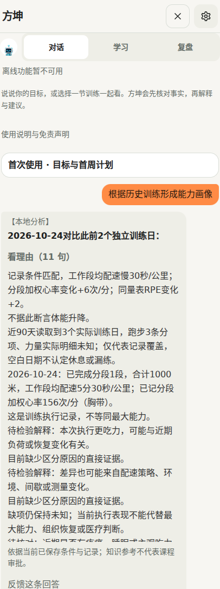
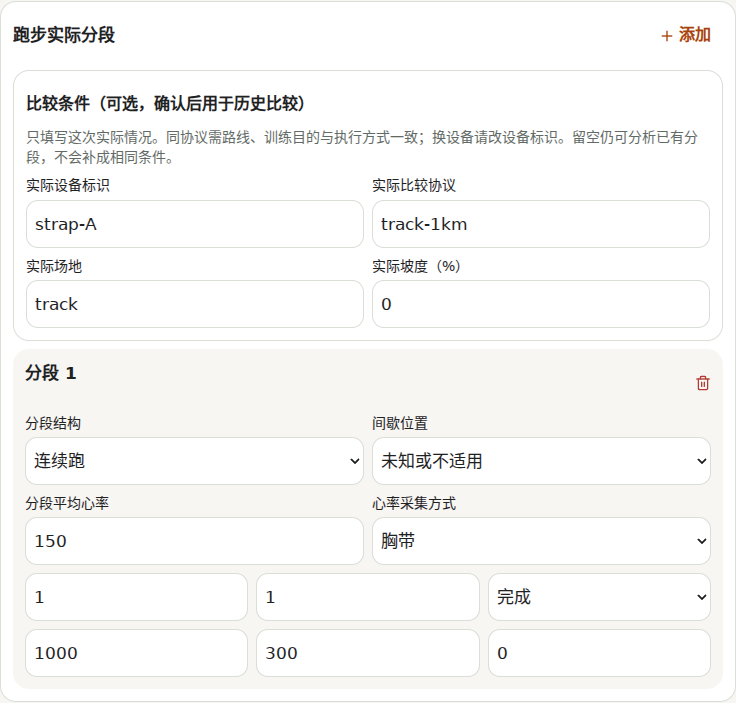
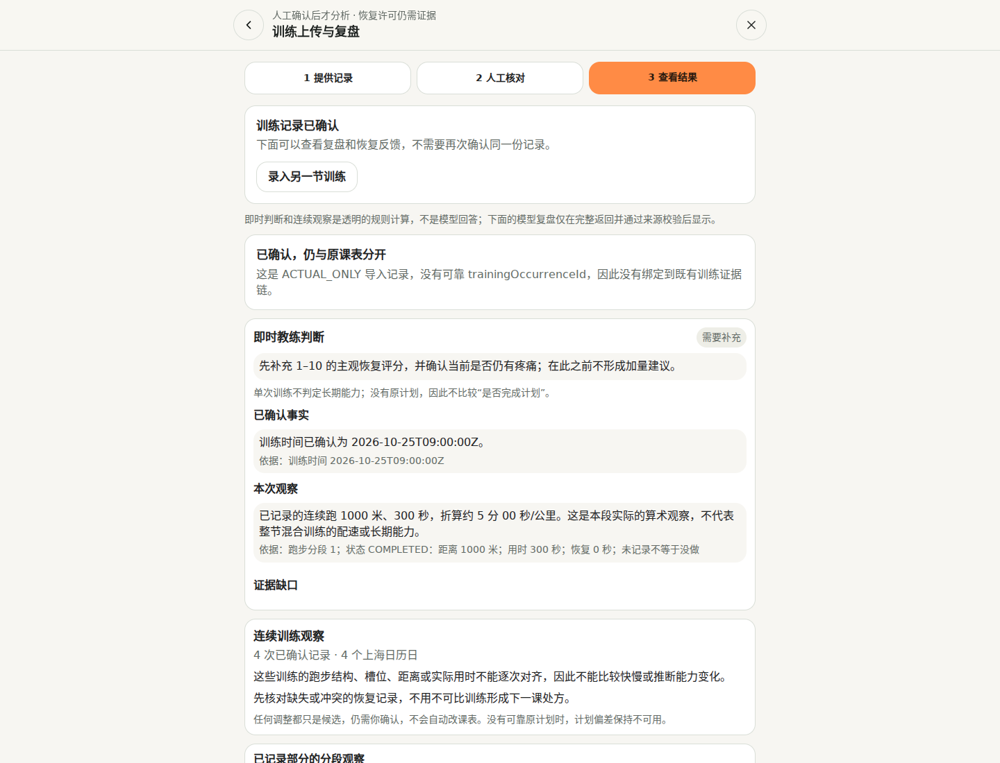
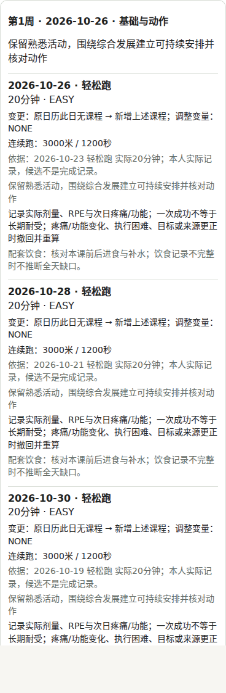

# R6 + R7 能力交付

沿用 PR #3 独立分支，在 R6 a586682 上追加 R7。开工和提交前核对的 master 为 c8053c8；未合并、未部署、未调用付费模型。R5 已在 master，R6/R7 在本 PR。

## 现在真正接通的能力

- 首次读取近90天已确认实际训练：跑步与力量分项分别保留；空白日期不认定休息或漏练，计划不当实际。
- 工作段配速、分段时长加权心率和同量表 RPE 历史比较。匹配来源、账号、设备、协议、距离/轮次、间歇及场地；分为记录条件匹配、有限可比和不可直接比较。
- 当前身份未知不能把历史中不同设备或协议拼成一个基线；缺分段心率或采集方式，不补心率、不只平均剩余部分。
- 现有训练页新增“补录实际训练”入口，沿用上传确认界面，增加离线手动录入和可选比较条件。编辑草稿不写实际；用户确认后保存，模型复盘是独立可选操作。
- 共享画像进入离线回答、在线事实入口、既有能力画像面板及周期草案。连续两次已记录条件匹配的执行更慢且 RPE 更高，只增加复核限制，不诊断疲劳，也不递增训练。
- 导入撤销/更正后重新读取：旧引用不继续进入当前画像；新记录、来源版本、安全限制会改变分析。
- 保留 R6 比赛目标到周期草案、仅最近一周确认、版本复核、拒绝/撤销、支持/削弱/撤回反馈；保留 R5 对话资料和计划确认、症状跟踪、周复盘。

## 本轮实际验证

- `node --import ./evaluation/deepseek-development/no-network.mjs --import ./scripts/test-register.mjs --test --test-concurrency=3 src/lib/coach/assessment/*.test.ts src/lib/core/training-import.test.ts`：30通过、0失败（聚焦检查）。
- 完整执行 package.json 中 `test` 的17个顺序命令，各组独立运行以保留所有失败：3964通过、7失败。每组原命令、耗时、退出码见 [regression.json](evidence/regression.json)。这是本轮实跑，不引用旧通过数。
- 其中 `npm run test:cycle` 覆盖 R6 周期及 R7 画像：68通过、0失败（R7新增19个用例）。
- `./node_modules/.bin/tsc --noEmit`：退出0。
- `npm run build`：退出0；未设置数据库地址，迁移按既有规则跳过。没有部署。
- `node evaluation/history/browser.mjs`：9个真实页面操作场景、浏览器错误0、模型请求0。覆盖确认前不写、确认写入、周期确认/撤销、日期反事实、疼痛阻止、历史配速/心率显示、离线对话、手动确认条件。使用公开合成记录，不是用户训练数据。
- `node scripts/browser-smoke.mjs`：开发和构建产物的桌面、移动端均通过，构建与开发无偏离。测试用浏览器关闭 service worker；这不证明 PWA 离线安装已通过。既有分享图提示仍为平台占位图。
- 初次测试实际观察到导入心率在分析适配中丢失（undefined ≠ 150），修复后真实确认存储链通过，见 [initial-failure.log](evidence/initial-failure.log)。

7项失败与本次开工前的基线失败名称一致；未为通过而修改旧测试：

1. 本机未完整取回原仓库二进制资产：anatomy-r9、R189动作/模型资产2项。Git树保留远端原SHA，没有删除这些资产。
2. 旧计划事实提示、知识来源离线策略、首屏水合、力量动作视图4项。
3. 旧力量逐组更正投影1项（期望1组、实际2组）。本轮导入撤销/画像重读已验证，但这条旧路径不能宣称全面可靠。

上述5项非资产失败在上一轮隔离 master 基线已经复现，本轮名称和断言仍相同。依据及旧基线验证见 [R6交付](../r6/delivery.md)。PR继续保持草稿。

## 示例（均由真实分析函数运行）

[examples.json](evidence/examples.json) 含7组输入变化后的实际输出：

| 输入变化 | 本次实际行为 |
| --- | --- |
| 记录条件匹配：1000米300→330秒，心率150→156，RPE5→7 | 慢30秒/公里、心率+6、RPE+2；列待检验原因，不直接判退步 |
| 改用另一设备 | 不计算跨设备配速/心率差值 |
| 实际间歇0→45秒 | 标记不可直接比较，不直接归因为体能下降 |
| 心率缺失 | 配速仍可计算；心率保持未知 |
| 同一课跑步加两组力量，其中一组重量未知 | 两项均保留，力量2个实际组；未知重量不补零 |
| 心率正常但有疼痛限制 | 限制继续生效，不放行 |
| 最新训练撤销 | 当前画像去除旧差值和引用，保留原记录链 |

## 页面证据

## 尚不能声称具备的能力

- 不能把本次工程测试换算成90分专业准确率；没有独立教练盲评、跨用户留出集或真实多周效果验证。
- 心率比较目前是已确认分段汇总；不自动从连续原始心率序列划稳定窗口，不计算实测阈值、最大摄氧量或组织恢复百分比。
- 旧记录缺设备/场地/协议时继续有限可比；新入口可供用户确认实际条件，不自动填充旧历史。
- 初始画像描述实际执行和覆盖，不等于完整能力评级。力量1RM、个体适应幅度、比赛成绩预测和营养全天完整度仍需进一步数据与校准。
- R6实际恢复链仍很保守：既有恢复评估不产生充分的正向递增许可；没有用“无痛”或正常设备分数绕过它。周期草案可给保守安排，不能承诺自动个体化进阶。
- 导入字段更正目前会撤出旧明细，不能保证每种更正都已自动重建完整新画像；旧聊天文字保留，R7未新增专门的跨消息撤回标记。R6周期草案已有反馈修订历史。
- 后台定时推送未实现，应用内生成/补生成能力沿用既有范围。

## 工程与专业判断分别评价

工程：确认存储→事实→比较→对话→周期约束的链路已经实测；类型与构建通过，有可复现页面与合成用例。全仓仍有7项失败，因此不标“全绿”或自动合并。

专业判断：更能辨认哪些数据可比、哪些不能推断，能提出有依据的保守候选；尚未证明能准确识别每个人的生理瓶颈或给出最优周期剂量，不能称90分私人教练。

## 回滚

不修改 master。本 PR未合并时关闭PR即可保持主线不变；如以后合并后需回滚，通过新分支/PR revert R7提交（或整个PR对应提交），不得硬重置用户历史。新增比较条件为可选字段，旧记录无需迁移。已确认计划使用现有撤销流程，不靠清缓存回滚。
