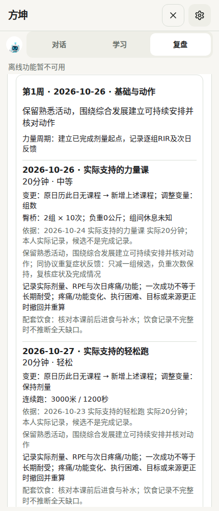
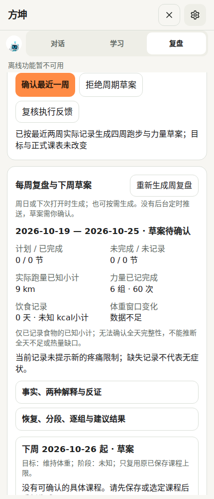
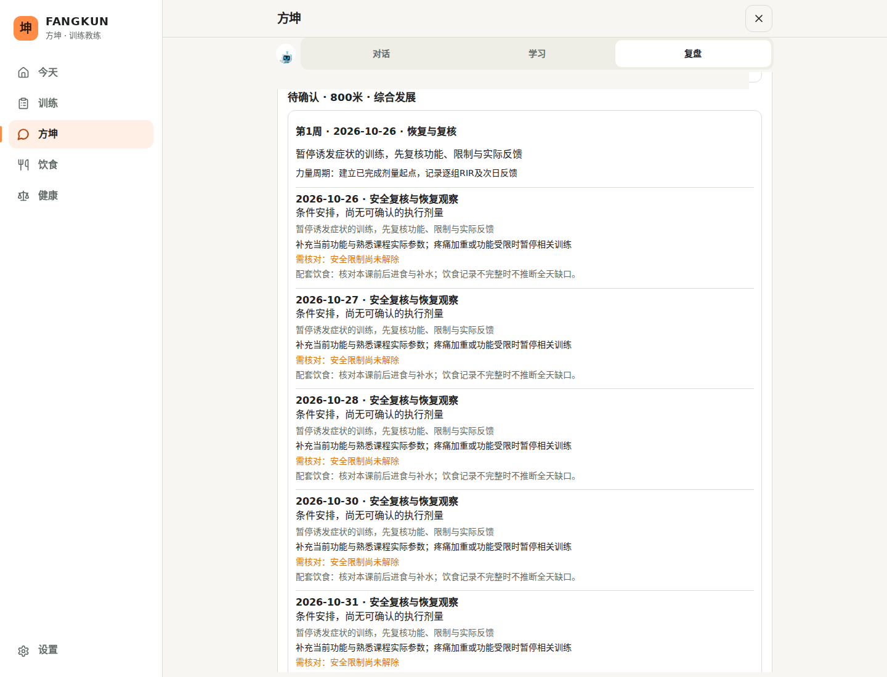

# 近两周实际训练 → 四周跑力草案：2026-10-25 交付

基线为已合并 PR #3 后的 master `0d8f4ca8239cedcce869918f4b44faacad281fa4`。独立分支 `codex/r8-adaptive-month-20261025`；未合并、未部署、付费模型调用 0。本文件与同目录 2026-10-12 的历史《验收报告》是不同轮次，旧通过数不用于本轮。

## 接通的行为

- 对话输入“根据我这两周的训练出后面一个月的训练计划，包括力量周期和跑步安排”，进入原周期确认流程；读取14天实际证据，输出4周草案，不覆盖已保存目标。
- 两个连续7日窗口分别显示实际跑步距离/时间、力量组数及混合课事件数。缺失仍未知，原计划不补实际。
- 能力画像沿用分段配速、按实际用时加权心率、同来源/设备/协议比较；目标成绩不能成为实测能力。
- 排课同时考虑跑步和力量候选，分别核对实际次数、距离、组数、时间与可训练日。无日历关联的完整连续跑、力量实际记录也可成为候选；力量第4周提供减组复核草案。后续周到期重新计算，不一次写入一个月。
- 高容量不设统一初学者上限：合成测试保留60公里跑步、12组力量、330分钟的一周。400/800/1500米场景保留已有、逐段证据一致的速度课轮次/间歇，不换成长跑模板。这些是功能反例，不是用户训练处方。
- 修复跨周相邻关键课、把严重疲劳误算成耐受、低恢复感未阻止有利判断等问题。新增逐段核验：连续跑总量不能冒充已经完成的间歇结构。
- 关联课后反馈必须匹配实际训练版本；重复可比症状可使力量候选从每动作3组减为2组。叠加训练单列，不冒充独立实验；更正/撤销后的旧反馈失配，不继续支持旧判断。
- 导入入口可补实际跑步类型及力量负重口径、左右侧、RIR、动作范围/协议；只在确认时入库。混合课整课时长不复制给每个分项。
- 当前无痛和功能正常只是“未见已记录不良信号”；疼痛、限制、冲突优先。旧固定疲劳分退出通用训练状态读取，原历史保留。
- 沿用版本复核、确认、拒绝、撤销和事实/安全核验。用户确认前不改正式课表。

## 实际验证

| 检查 | 实际结果 |
| --- | --- |
| package.json 的17个测试命令完整逐组执行一次 | 3982通过、8失败；原始命令/耗时/失败详情见 evidence/regression.json |
| 收尾定向复验：周期、画像、恢复链、逐组纠错、导入 | 146通过、0失败，见 evidence/focused-final.log |
| TypeScript `./node_modules/.bin/tsc --noEmit` | 退出0 |
| `npm run build` | 退出0；数据库未配置，既有迁移脚本跳过；仍有大chunk提示 |
| 合成数据经真实导入/存储及页面操作 | 6场景通过，页面异常0、模型请求0；8张截图 |
| 开发及生产桌面/移动页面烟测 | 两次退出0；4视口页面/控制台错误0、横向溢出0；生产与开发正文基线一致 |
| 5组前后对照输出 | 运行 `node --import ./scripts/test-register.mjs evaluation/adaptive/examples.ts`，见 evidence/examples.json |

定向复验命令：

```sh
node --import ./scripts/test-register.mjs --test --test-concurrency=3 src/lib/coach/cycle/*.test.ts src/lib/coach/assessment/*.test.ts src/lib/health/coach-chain-v14.test.ts src/lib/health/recovery-host-u11.test.ts src/lib/core/training-import.test.ts
```

构建日志只清理行末空格，数值与结果不改。浏览器使用合成访客、API桩与禁用Service Worker的上下文；这验证本地分析与界面，不代表已验证PWA后台/真实云服务。

全回归实际使用工作区顺序执行器（完整命令见JSON）；可复现等价执行器在 `evaluation/adaptive/regression.mjs`，用 no-network 预加载阻止模型和外部请求。测试组有交集，以上次数不相加当独立科学样本。烟测调用原 `scripts/browser-smoke.mjs`，开发8080、生产8081，生产使用开发JSON作baseline；运行环境预加载仅配置Chromium/模拟断开设备API。初次烟测发现访客按钮点击早于水合，复验等待 `training-app[data-ready=true]` 后点击，最终正文基线一致。已有分享图占位品牌警告保留，不属于本轮教练逻辑改动。

8项初次失败中，1项是本轮更严格“缺功能反馈不能报告已核对限制”的旧断言，已更新并复验；1项是旧纠错测试把提交时刻设在所查询本地日期结束之后，已修正测试时刻，原断言保留并通过。剩余6项：本地缺原始二进制资源导致2项资产检查失败；4项旧失败涉及计划事实提示、离线知识来源、首屏水合源码约束、力量动作视图。名称与前轮基线相同。本轮未重跑第二次全量，不能将复验推算成一次新的“全量全绿”结果；PR保持草稿。

## 五组真实函数输出对照（合成，非本人训练）

| 输入改变 | 改变前 | 改变后 |
| --- | --- | --- |
| 同口径两次已关联课后酸痛 | 力量每动作3组 | 2组候选，负重和次数不增加，提示复核 |
| 新增疼痛限制 | 最近一周可确认 | 暂停确认并给安全复核安排 |
| 力量负重字段缺失 | 有实际逐组依据 | 不用计划重量补齐，不输出可确认的该动作 |
| 更正一条历史训练版本 | 两次反馈支持复核 | 旧关联失配，重算计数，不沿用旧支持 |
| 800米目标改为90秒 | 实际成绩未知 | 仍未知，不能把目标变成能力 |

基准合成例中，一周是3次3公里跑、2次3组臀桥；它只是小样本测试输入，因此生成小容量，不能据此说产品只支持小课表。高容量和专项结构反例另有回归。**专业性不等于课表更大：当前主要是实际证据约束下的保守草案生成器，尚未证明能找到个人最佳训练刺激。**

## 必须公开的限制

1. 仅两周资料不足以确立最大能力、长期耐受或最佳周期。可比性严格；换设备、协议或结构缺失时，只提供能支持的部分。
2. 未关联日历的原始间歇、混合课、不同组不同重量、单侧/每手负重，尚不能全面自动编成正式课表；保留实际分析并提示核对。已有间歇课必须匹配逐段距离、用时、轮次及休息才能复制，暂不自动放宽容差。
3. 默认每天只提出一节新课，已有课不覆盖。高水平运动员同日双课、复杂专项强弱微周期、完整最大力量→爆发力转换并未完成。不能把“4周均有安排”宣传为专业最优周期已解决。
4. 第4周减组、两次反馈门槛、跨日间隔是可复核产品策略，不是已校准的生理规律。恢复时间、组织恢复百分比、损伤概率不输出。
5. 个体化目前为描述性反馈修订，不训练模型权重；运行记录可支持/削弱/撤回，不能证明因果。尚无个人前瞻训练效果验证或盲测教练评分。
6. 既有其他旧疲劳分展示/规则未全仓删除；本轮只移除通用状态读入的伪精确分数。后台推送、真实设备账户同步及付费模型现场答卷未在本轮验证。
7. 现有UI、V4、Garmin/COROS、数据和鉴权保留；没有清缓存、重置或静默覆盖。

科学依据及外推边界见 [science.md](science.md)。工程评价：本轮主链有局部、实际页面、类型与构建证据，但全仓仍有旧失败。专业判断评价：可核查、更能处理反证的保守教练助手；不能称90分或等同专业教练。

## 考查入口与回滚

在方坤对话输入：**“根据我最近两周实际训练，判断跑步和力量能力，安排后面四周训练。保留我的实际训练量；说明关键课、组次、间歇和依据。缺少的数据说明未知，先给草案。”** 随后可追加疼痛、换设备、更正记录，看它是否修订依据，确认前课表应保持原样。

完整源码从 GitHub 本分支下载，保留原树全部资产；增量见PR Files changed / `.patch`。改动清单见 evidence/changed-files.txt。未合并时关闭PR即可；如以后需回退，另开分支revert本提交/合并提交后走PR，不强推主线、不清数据。已接受的课表走应用撤销，并复核版本。

## 页面证据






