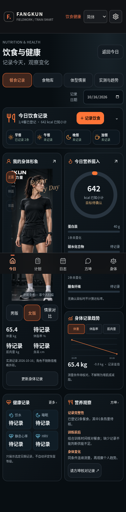
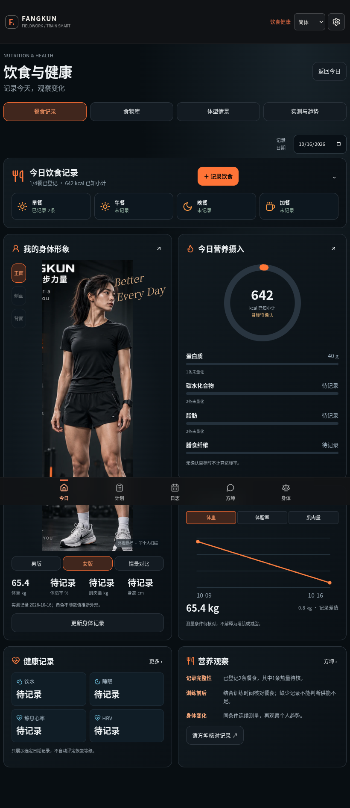
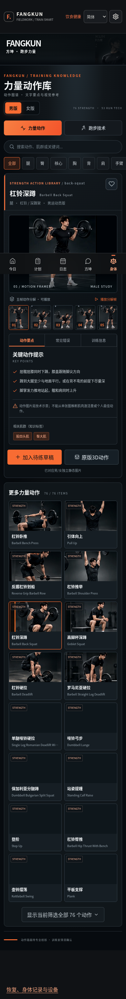
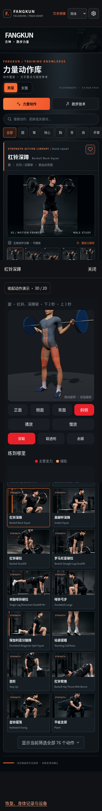
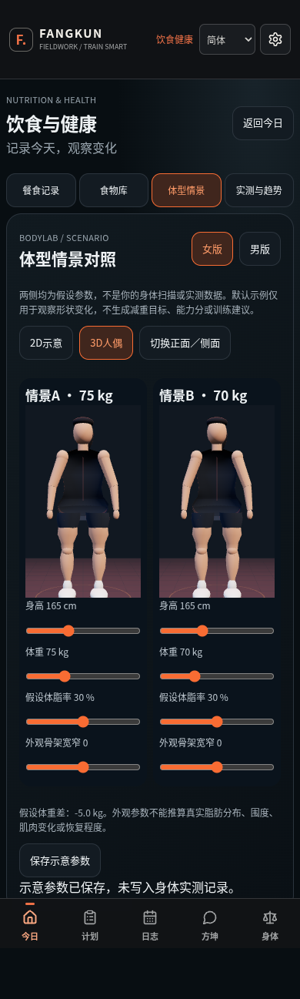
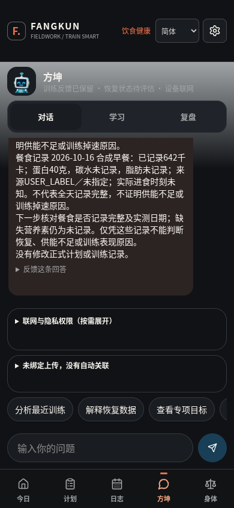

# 方坤 UI 20261016：Codex 交付说明

本包是本次 01—04、05A—05G、06 共 12 个独立包的集成候选，基于上一版 FIELDWORK V4 完整源码开发。按用户最后发的饮食健康参考图，采用深色橙色、餐食总览、人物与营养双列、实测趋势和健康信息的布局。已完成构建，可以交给 Grok 本地接手；尚不具备完整生产离线验收通过结论。未部署，未覆盖正式版本。

## 实际实现

| 模块 | 已接入的行为 | 边界 |
| --- | --- | --- |
| 动作库 | 76 个力量、53 个跑步技术稳定 ID；搜索、分类、收藏、男女静态图、深蹲逐帧；打开原有 3D；保存待练草稿 | 草稿剂量默认空白，需用户确认，不自动改正式计划；不是每个动作均有独立图或动画 |
| 饮食健康 | 地区/品牌食物检索、份量换算、手动餐食、自定义标签、未知营养值、更正与删除历史、已知摄入小计 | 中国条目缺值不借用美国数值；目录标签不是新获科学核准的营养处方 |
| 最新参考图布局 | 手机双列人物与营养、餐次概览、热量环、宏量营养、实测趋势、健康信息、方坤入口 | 示例里的 1280/2000、72.4 等数字未写成用户事实；无确认目标不伪造达成率 |
| BODYLAB | A/B 参数情景、2D 与本地 Three.js 3D 示意、参数保存与恢复 | 与实测体重/腰围分开存储；不是扫描、减脂预测或真实体型重建 |
| 首页 | 今日训练/动作库/饮食健康卡片移动、桌面拖动和顺序保存 | 原五个底部导航及训练结构继续保留 |
| 方坤联系 | 餐食与实测事件进入原事实层；入口预填核对问题；回答使用已记录的 642 kcal、65.4 kg 等合成数值 | 不自动发送、不调用外部模型、不将视觉参数当健康事实 |

现有训练事实层、事件更正、备份、离线教练与医学安全门控继续使用。未重新实现另一套 AI Brain。恢复数据源没有运动员归属的旧记录仅在 local 档案下显示，防止混入其他运动员。

## 本轮实测结果

| 检查 | 结果 | 原始证据 |
| --- | --- | --- |
| 12 个文件的定向合成测试 | 601 PASS / 0 FAIL / 0 SKIP | evidence/ui-20261016/unit/summary.json 与各日志 |
| 开发版真实 Chromium UI 流程 | 36 PASS / 0 FAIL；0 页面异常、0 模型请求 | evidence/ui-20261016/browser-dev.json |
| TypeScript | PASS | typecheck-04.log |
| 最终 Vite/Nitro 构建 | PASS；无数据库配置时按原逻辑跳过迁移 | build-final.log |
| 最终生产版离线浏览器 | 未执行完成，不计 PASS | 已有待执行脚本；无 browser-prod.json |
| 完整项目回归、真机 Safari、六语新文案 | 本轮未执行 | 不沿用历史结果冒充本轮通过 |

开发版浏览器已实际操作：刷新恢复首页顺序；男女素材与女性 3D 缺失提示；空剂量草稿；中国食物未知热量保存；321 kcal 更正为 642 kcal 且保留旧事件；实测趋势；体型情景不写实测；两个真实 WebGL 画布；原 GLB 渲染；方坤读取实际数字。开发浏览器拦截了外部网络，但这不等于已验证生产断网刷新。

尚待执行的生产脚本覆盖 Service Worker 刷新、已缓存图片、离线方坤与急症、存储失败注入。预览启动后测试调用被中断，随后按用户“构建好就发我”交付；不可将脚本存在写成通过。601 项中含 482 项既有安全规则检查，未降低断言或放宽安全门控。

## 本轮失败与修复

- 旧调用方默认餐食热量一定为数字：引入 null 后补齐数值过滤、未知提示及来源说明，避免缺失值变成 0。
- 首页旧偏好写入可能覆盖新增字段：扩展原偏好结构，保留语言、性别、排序、收藏和体型情景。
- 旧人体演示与新版女图不能混用：女版缺少兼容 GLB 时明确提示，不以男体冒充。
- 迁入原型可能依赖全局样式/自建演示存储：将样式限定到模块，真实记录仍接原事件事实层。
- 初始检查也发现测试环境问题：JSON 导入属性、测试内存存储缺少 length/key、类型收窄、Playwright 默认浏览器不存在。补齐测试适配，使用系统 Chromium。
- 开发浏览器最初误把“不得套用美国 580 kcal”的来源说明当计算结果；改为检查实际计算区域，同时验证持久化为 null。原失败日志保留，最终重新运行 36 项通过。
- 最新饮食布局的背景受旧主题渐变影响：限定深色背景；390 和 820 宽度无水平溢出。

## 图文外观交接

以下是本轮实际 Chromium 截图，全部使用合成记录，不是参考图冒充运行效果。页面高度超过视口时全页截图可能把固定底栏显示在中段，这是截图方式，不是卡片中的导航。

### 饮食健康：手机

人物和营养在手机保持双列；截图中选择了女版，可切换男版。所有数字来自测试操作；空数据下显示待记录。应保留人物图与原有 3D 资产，不能在本地启动时替换成另一套角色。

### 饮食健康：宽屏

### 动作库与原人物

### 体型情景与教练联系

## 给 Grok 的启动和素材约束

1. 完整源码包或四个互补小包二选一。小包必须全部解压到同一个父目录，合并 `source/`，不是用 cat 拼接的二进制分卷。
2. 最新入口是 `UI-20261016-先读我.md`。旧 R185/R188/FIELDWORK 文档仅保留历史意义，不代表当前验收。
3. 使用 Node 22，按已有 `package-lock.json` 安装：`npm ci`；`npm run typecheck`；`npm run build`；本地 `npm run preview -- --host 127.0.0.1 --port 8097`。数据库迁移仅在有配置时执行；不要为 UI 演示改生产配置。
4. `public/demo3d/models/human.glb` SHA256 必须保持 `cbf479cf66cb281b96d83b41816b5894e4f9da9833c015821b95499c9440353c`。本轮没有换为附件中压缩过的另一份模型。`public/fangshen/` 是已有方坤立绘；`public/fangkun-atlas/assets/` 是新库 64 张原样图片；`public/fangkun-bodylab/` 是独立参数人偶与本地 Three.js，不能拿它替换原动作演示人物。
5. `asset-manifest.json` 给出素材逐文件哈希。不要重命名稳定动作 ID，不要用 CSS 滤镜冒充女版，不要生成假侧面/背面。06 用户视觉参考不作为运行时产品素材打包。
6. 使用空白的测试浏览器档案；不要清空用户 localStorage、训练事实、日志、历史判断、备份或导入记录。真实用户数据不在交付包内。
7. 本轮定向测试复现：对 `unit/summary.json` 中 12 个文件逐一执行 `node --import ./scripts/test-register.mjs 文件路径`。脚本 `scripts/run-ui-20261016-tests.py` 和浏览器脚本内保留本次环境绝对路径；在其他机器需修改 Node、Chromium、证据输出路径。不得因此改动产品行为。
8. 生产离线待验收：启动8097后执行 `node scripts/ui-20261016-browser.mjs prod http://127.0.0.1:8097`；需可用本地 Chromium，修改脚本中的 `/usr/bin/chromium` 为本机路径。结果必须重新记录，不沿用开发模式的 36 项。

## 尚未具备的能力

- 女性同骨架动作 GLB、部分女性跑步图、饮食形象侧/背素材尚缺，相应入口诚实提示或禁用。
- BodyLab 是参数人偶，尚非最终高保真人物资产，也不证明真实生理变化。
- 新饮食看板的饮水、膳食纤维、营养目标编辑还未接通；无目标不出百分比。旧健康页面仍保留。
- 新增专业页面主要中文；原六语外壳保留，不宣称新增内容全部完成六语验收。
- 人物/动作图只作示意，未获运动科学动作审核或医学用途认证；候选知识没有自动升级为处方。
- 生产版完整断网验收尚未跑完。尤其从未访问的资源不应宣称已缓存可离线。

## 修改范围与回退

`modified-files.csv` 是相对上一版完整源码逐文件计算的新增、修改、删除清单；`验收结果.json` 是本轮唯一机器可读结论。源码与日志分包不含 node_modules、构建缓存或凭据。

回退点是 `before-ui-integration-full-source.zip`，SHA256 `a03e6e15dd94dfa97b20c135dad5f86930b5839beaaa56d4fb546ed233b08d3d`。另给小型代码回退包，包含被修改文件的原版及新增文件清单；按 README 手动核对后恢复，后续改动需先合并，不删除用户数据。

可以进入下一轮本地集成验收；不能标为整项目或最终离线验收 PASS。本轮没有部署或发布。
