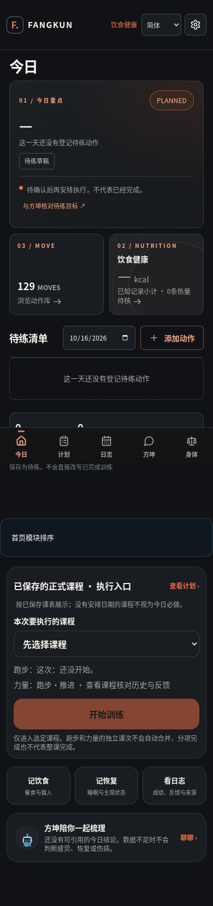
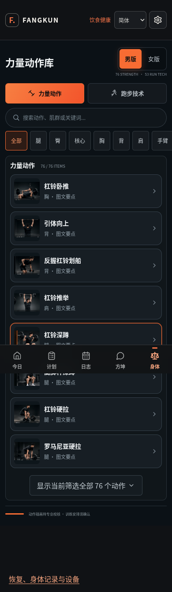
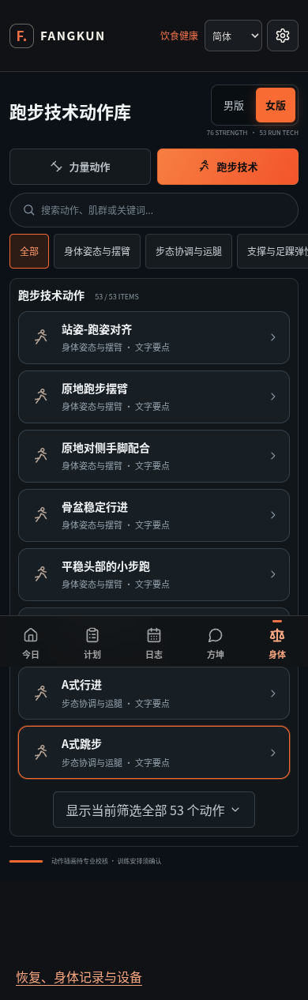
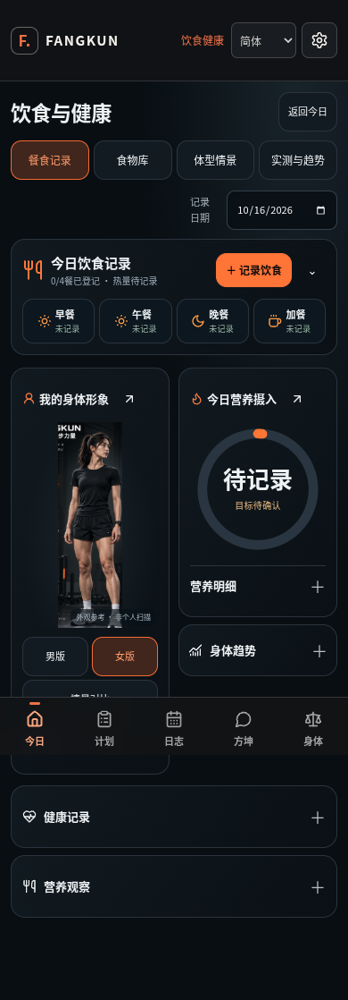
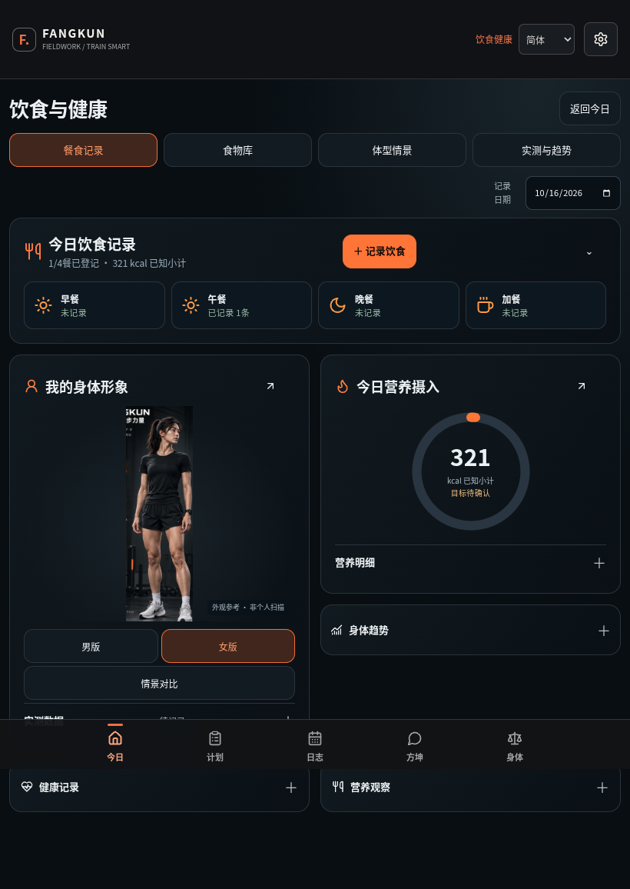
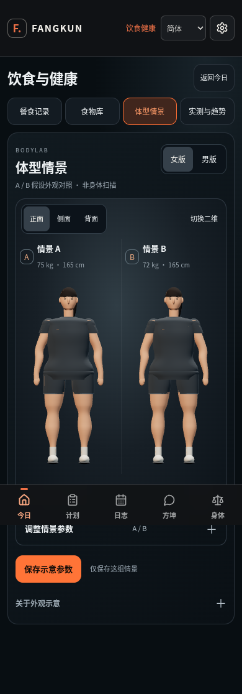
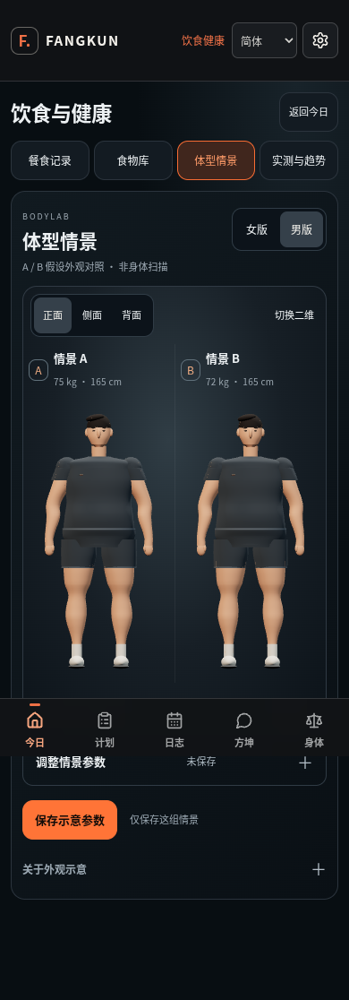
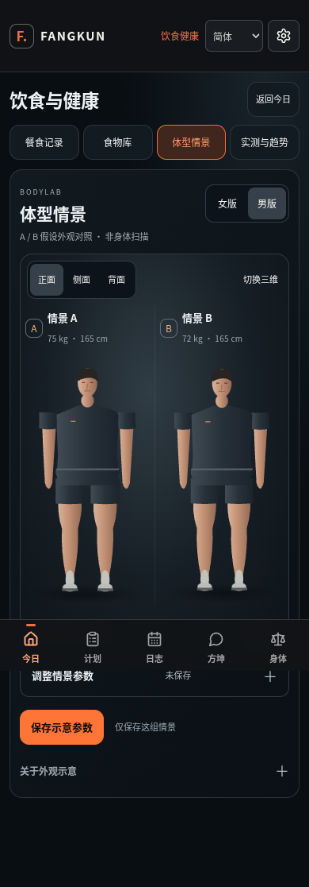
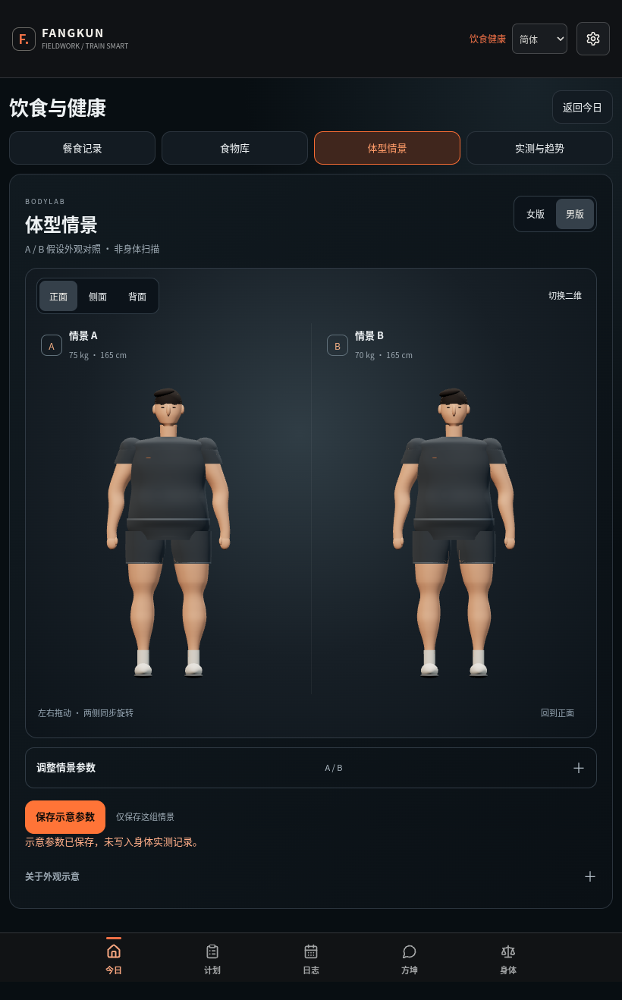

# 方坤 UI 精修交付 · 20261016

本轮仅修改 UI 和页面交互，教练逻辑、训练事实、数值计算、安全门控、正式计划和用户记录没有改动。以此前已交付的完整源码为回退基线，保留原动作 GLB。此次不是新一轮教练开发，也不宣称整个项目验收通过。

## 完成的五项修改

| 请求 | 实际变化 |
| --- | --- |
| 压缩首屏 | 首页去掉重复说明大标题；主要训练卡片下并列动作库与饮食入口；排序设置移到主要内容后 |
| 手机层级 | 精简页面头部、留出触控高度；次要信息按需展开；390/820/1440 宽度检查无横向溢出 |
| 去掉动作库空白占位 | 首次打开先看 8 个动作条目，点击才展开详情；缺图条目直接使用紧凑文字行；图片加载失败时收掉图片区；没有结果时不显示不相关旧详情 |
| 饮食折叠 | 首屏保留当日餐食和人物/营养双列；点击餐次只展开该餐；可收起并记住选中餐次；保存后自动展开已保存的餐次；营养明细、实测、趋势、健康及观察各自展开 |
| BODYLAB 统一 | 自然成人比例的二维示意与三维人物采用一致深色运动服、暖肤色和棚拍光感；连续四肢轮廓替代球形关节；更一致的 A/B 取景；同步旋转、正侧背视角、参数收起及 A/B 单独编辑 |

BODYLAB 仍是参数化示意人物，不是照片级数字人、身体扫描或减重预测。二维是备用轮廓表现，三维是默认展示。原有 `computeProfile` 与假设参数保存结构未变，模拟参数不会写入身体实测。原动作演示人物及方坤立绘也没有替换。

## 实际检查

- 开发版 Chromium：34 PASS / 0 FAIL。
- 最近构建版 Chromium：35 PASS / 0 FAIL；35 项预定断言中 0 项在该次运行未完成。该次已执行部分未捕获页面异常 0 项。状态：`UI_TARGETED_CHECKS_PASS`。
- TypeScript 与最终 Vite/Nitro 构建通过。数据库配置为空时按原逻辑跳过迁移；保留构建的依赖警告原文。
- 505 个受保护文件逐文件 SHA256 相同，包括 src/lib、server、knowledge、体型计算模型及原动作 GLB。
- 浏览器检查方案包含合成餐食 321 kcal 的保存展示、折叠与重新展开、体型情景保存/刷新、已访问 UI 的断网刷新恢复、正式计划不变及无云端模型请求。开发版未运行断网检查；构建版各项真实结果以 `browser-prod.json` 为准。未完成项不能视为通过。

开发检查发生在最后的 BODYLAB 取景微调和首页样式优先级修复前，构建版检查对应最终运行代码。此前交付的 601 项、36 项及更早阶段计数不算本轮重跑。

### 发现与修复记录

- 构建版首页曾被旧样式覆盖，导航卡片挤出首屏：提高限定于本页面的样式优先级；保留 `browser-prod-before-css-fix.json`，修复后的首屏断言已通过。
- BODYLAB 新增取景参数曾触发 TypeScript TS2353：补齐 JavaScript 参数类型声明；保留 `typecheck-reviewed.log` 及修复后通过的 `typecheck-verified.log`。
- 开发版首次 Chromium 启动因沙箱套接字权限失败，未进入页面；获本地浏览器运行权限后完成 34 项检查。
- 构建版运行曾在截图处超时：保留 `browser-prod-screenshot-timeout.json` 与日志。截图等待改为 60 秒并关闭截图动画，断言保持原要求；导航及 Service Worker 等待也设有超时。另有工具中断和刷新关闭，不能据此宣称持久化或离线验证已通过。最终运行结果单独保留，不覆盖上述失败记录。

本轮没有执行教练回归、真实用户数据测试、iPhone 真机 Safari、PWA 安装或全量未访问资源离线测试。UI 的定向通过不能替代整个 AI 教练闭环验收。

## 运行截图

以下为本轮最终运行代码在 Chromium 中的实际截图，可能来自不同次运行；记录均为合成数据。截图只能证明已显示的页面，不能替代刷新或离线验收。全页截图中固定底部导航可能出现在页面中段，这是截图方式。手机与宽屏截图均已查看。

### 首页与动作库

### 饮食健康

### BODYLAB

## 接手约束

1. 最新入口是 `UI-POLISH-20261016-先读我.md`；旧 UI-20261016/FIELDWORK/R185 等文档仅保留历史，不是本轮结论。
2. 完整源码与 UI 增量补丁二选一。补丁仅适用于上一版 `fk-ui-20261016-full-source.zip`，基线 SHA256 为 `154b93183be10b6ddbc5146726511d3e9edd42c84f0b9b05e5fda32f05964e5c`。若已另作修改，先合并再应用。
3. `人物与计算边界.json` 记录本轮人物渲染文件和原 GLB 哈希。不要把 BODYLAB 换成动作库人物，不要用男体代替尚缺的女性动作 GLB。不要把参考图的数字或假设体型写成用户记录。
4. Node 22，沿用 package-lock：`npm ci`、`npm run typecheck`、`npm run build`。本轮未改依赖或运行配置。不要清空本地用户数据或自动部署。
5. UI 复现脚本：`scripts/ui-polish-browser.mjs`。支持 `CHROMIUM_PATH`、`EVIDENCE_DIR`、`SCREENSHOT_DIR` 覆盖本机路径；启动本地预览后传入地址及 `prod` 模式。脚本只生成合成数据，不向外部模型发送请求。
6. `修改文件.json` 是相对上一版的产品与测试文件清单；新文档、截图另在本目录。日志包保留原始失败与最终结果，不能只抽取 PASS 计数。

## 回退

完整回退点是上一版完整源码 ZIP，哈希同上。另有小型代码回退包，含改动前文件和新增文件清单；仅按哈希核对后恢复/移除对应源码。已有后续修改时先合并，不清空 localStorage、IndexedDB、运动员事件、日志或历史判断。本轮未部署。
