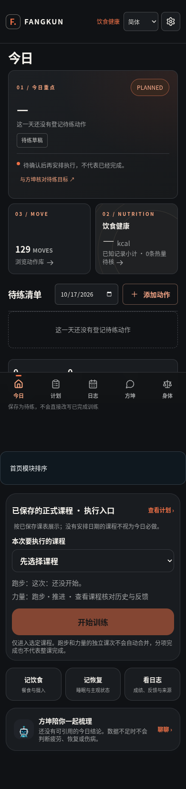
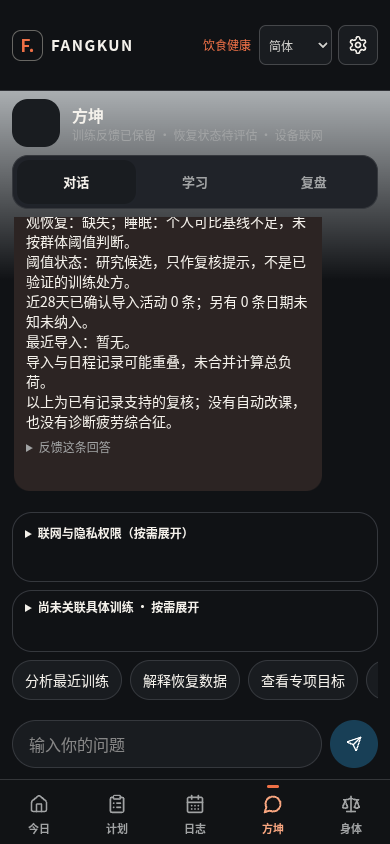

# 方坤 v74 健康核心最小集成交付

本包在最新 R4 修复版上接入并补强 v74 的健康事实与离线教练能力。**不是把用户上传的 v74 整包覆盖到旧版，也不是 v74 全 UI 合并验收。**

## 基线与范围

- 回退基线：`fk-brain-r4-full-source.zip`，SHA256 `13d3ccdbef3c549c8591807481f4232dc18a6beba1bd7a1e0de564c826c1cdfb`。
- 四个输入分包的 CRC 与清单中 882 个文件 SHA256 全部匹配；原附件未修改。
- 修改现有文件 5 个，新增功能/测试文件 12 个；详见 `修改文件.json`。
- 207 个受保护文件逐字节不变，包括 73 个页面组件、样式、130 个资源文件及 R4 核心修复。
- 不改 UI、人物、正式计划或用户训练记录；没有部署、付费模型调用或真实健康数据测试。

## 实际可用能力

| 能力 | 实现与边界 |
|---|---|
| 健康来源与更正 | 同一观测更正保留原 ID、旧值和来源；旧同步不能覆盖新更正；跨指标/日期复用标识会拒绝。独立冲突记录保留，不平均、不选任意一个。 |
| 数值与缺失 | 设备睡眠秒数完整保留，按小时分钟回答；夜间/运动平均心率不充当静息心率；当日最高电量不当成当前值。 |
| 个人比较 | 只取前 7 个日历日内同来源/口径的可比记录日；缺失不补零。算法未知的 HRV 不算个人基线；冲突日排除。 |
| 疲劳复核 | 主观、睡眠、自主神经信号分别列示；HRV 与静息心率不算两类独立证据。经验阈值标记 RESEARCH_CANDIDATE，不能决定减量、停训或医学回归。 |
| 安全 | 疼痛与急症优先；疼痛跟进不要求用加速或负重试探；正常设备值不解除限制。 |
| 现有离线教练 | 在现有对话入口回答健康问题，每轮重新读取本地事实；实际回答含具体数值、来源、日期和不确定性。单课分段、掉速及休息复盘不被每日健康回答替换。 |
| 训练均衡 | 复用事实层的已完成课次；兼容读取 v74 日程时把计划与实际分开，重复标识排除。导入活动、兼容日程和正式课次分别列示，绝不相加冒充总训练课次。 |
| 隔离与失效 | 按运动员隔离新健康写入和读取；未标识的旧健康记录仅归属 local。导入活动复用现有运动员筛选和撤回规则；距离/时长有更正时不引用旧总量。 |
| 本地映射接口 | 提供纯函数 `garminHealthDay` 与 `deviceEvidenceHealthRows`，校验日期、单位、确认状态与部分失败；不登录账号、不发网络请求、不自动导入截图或活动。 |

`saveDeviceRows` 仅保存明确传入的健康行；活动仍走现有训练导入核对合同，体重仍在现有体测页确认。兼容读取旧 v74 存储键不等于新页面已经合入。

## 实际测试结果

| 检查 | PASS | FAIL | SKIP | 日志 |
|---|---:|---:|---:|---|
| 完整 npm test 链 | 2351 | 0 | 5 | `10-full-npm-test.log` |
| npm test 未覆盖的 74 个既有测试文件 | 1003 | 0 | 0 | `16-extra-regression-recheck.log` |
| 合计（不重复累计定向重跑） | **3354** | **0** | **5** | `验收结果.json` |
| 开发版浏览器 | 12 | 0 | 0 | `browser-dev.json` / `19-browser-dev-recheck.log` |
| 构建版浏览器 | 12 | 0 | 0 | `browser-prod.json` / `21-browser-prod.log` |

TypeScript 检查及最终构建均 PASS。Node v24.19.0；已核对 TypeScript、React、Vite、Zod、TanStack Start 和 MiniSearch 的安装版本与锁文件一致。附件声称的 1041 项历史 PASS 没有算作本轮结果。

浏览器使用全新合成数据上下文：390px/1440px 页面实际渲染，睡眠 7小时15分 → 更正后 6小时45分，断网回答，构建版断网刷新与再提问，保留更正与对话，急症优先，正式计划不变，未出现 POST/模型请求或未捕获运行错误。浏览器测试脚本在 `scripts/health-v74-browser.mjs`。这是 Chromium 验证，不代表真实 iPhone。

5 项 SKIP 分别是 v74 新健康卡片渲染、来源详情渲染、v74 活动导入器与日程的组合场景、新打卡卡片、v74 多文件预览合并。这些入口没有合入。现有活动导入与隔离另有已运行测试，但不能代替上述五项场景。

## 失败与修复记录

1. 初次移植运行失败：当前 R4 营养日志不导出 v74 的 aggregate。改用现有日志，只汇总已知值，保留缺失计数；日志 `02-health-initial.log`。
2. 初次类型检查失败：移植接口和类型守卫的窄化错误。修复实际接口/类型；日志 `01-typecheck.log`、`05-typecheck.log`；最终 `17-typecheck-final.log` 通过。
3. 初次额外回归 1002 PASS / 1 FAIL：设备映射返回类型名触发旧品牌名称静态检查。改为通用 `DeviceDayResult`；未改断言。全部 1003 项额外回归重新运行通过，原失败日志 `11-extra-regression.log` 保留。
4. 补强 HRV 算法未知仍入基线、旧同步覆写、观测标识混用、同源独立冲突、运动员隔离、不可读存储、经验阈值处方化风险和导入旧总量失效；20 项新增回归与 37 项适用上游测试已在完整测试链执行。

## 未解决/未验收范围

- v74 的新健康来源选择页面、手表模式设置、Garmin 登录/同步界面、截图转健康按钮与其余 UI 资源尚未合入；现有页面不换样。
- 健康来源冲突目前可用调用接口选择；现有 UI 没有新增 v74 来源选择器。没有真实 Garmin 账号/设备、FIT/GPS 或跨时区旅行验收。
- 经验疲劳阈值没有科学核准；不能据此开处方或产生 0—100 真实能力分。本轮没有训练参数学习或成绩预测。
- 被更正的导入总距离/时长暂显示未知，需在现有单课事实视图核对；不会从不明单位更正文本猜总量。
- v74 兼容日程不自动与正式课次关联；未确认关联前不计算合并负荷。旧记录无运动员标识时不分配给其他运动员。
- 只读健康基线描述已保存记录，未做前瞻性效果验证或完整历史 as-of 回放。身体人物、完整新 UI、真实设备与云端模型不在本轮验收范围。

**可进入 Grok 对本次健康核心集成的独立测试；不能将本次结果写成“v74 全部模块已集成/可上线”。**

## 源码、图片与回退

完整源码用 01—04 四个独立 ZIP 交付，全部解压到同一空目录，合并 `source/` 即可；不要与最初上传的 v74 四包混解。02—04 与 R4 资源包逐字节相同，保留既有人物/UI。01 含当前代码、依赖锁、测试脚本和本说明。

增量包基线仅适用于上述 SHA256 的 R4 版本，不应直接覆盖到 Grok 的另一个 v74 分支。日志包保留首次失败与最终通过。`fk-v74-rollback.zip` 含被改的五个原文件、新增文件删除清单及回退核对脚本；完整 R4 基线也保存在本地 rollback 目录。回退不操作浏览器本地存储或训练数据。

以下是本轮实际浏览器截图，仅作核对现有界面；不代表 v74 新 UI 已合并：

