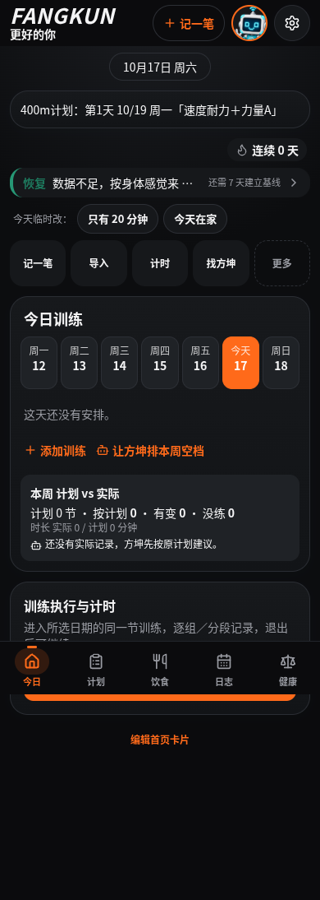
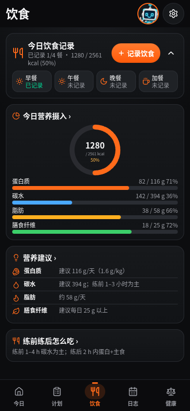
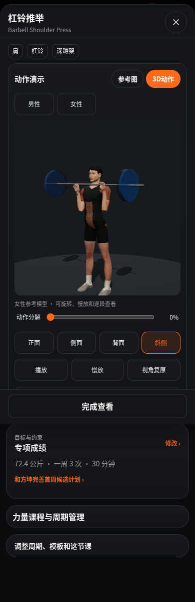
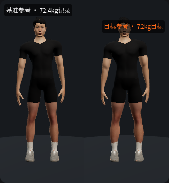
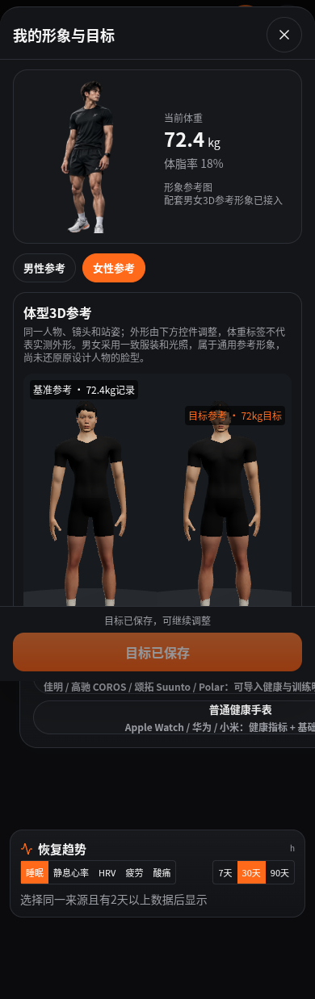
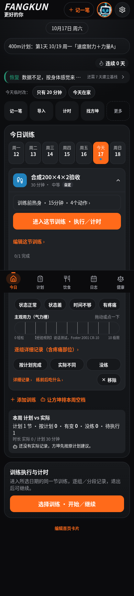
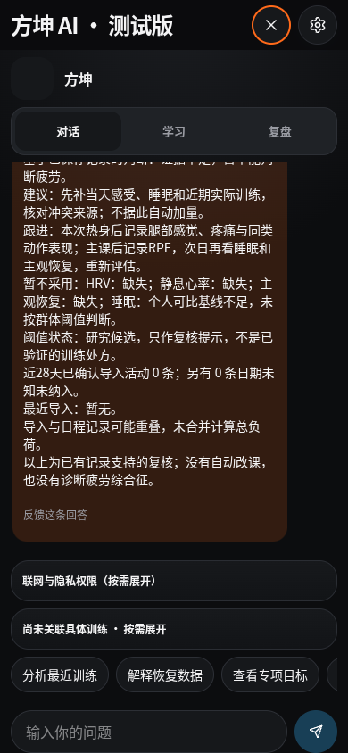
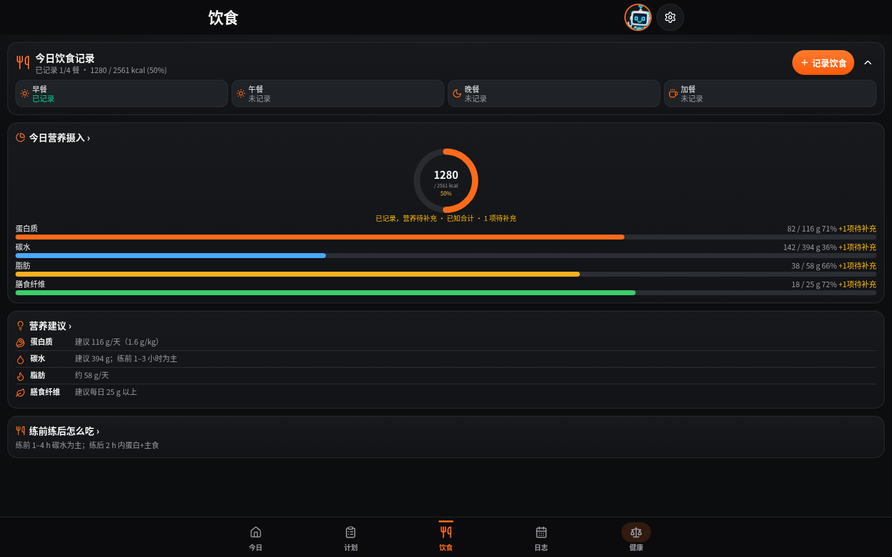

# 方坤 V74 UI 集成候选交付

基于用户上传的最新 V74 UI/资源与已有 R4、健康事实修复整合。没有从头重建；手机 V70 和正式站点均未修改。本包用于 Grok Bot 独立本地复验。

## 已实现

- V74 首页、训练计划、力量动作库、饮食和健康页面，以及新训练编辑、热身、分轮结构、按日期安排与数据来源交互。
- 保留较新的本地教练、安全门控、事实更正、跨课隔离和候选计划机制；避免被 V74 另一分支中的旧逻辑覆盖。
- 内置 76 个力量动作入口映射到本地 3D，配套男女参考模型、前侧背视角、慢放、动作分解、二维备用和重试；独立肌肉模型与扩展动作文字入口保留。
- BODYLAB 与动作演示统一模型、光照和服装；基准/目标参考外形可调，男女参数分别保存，刷新恢复。外形参数不会改写体测值、健康记录或正式计划。
- 显式下载动作资源，缓存男女模型和所需模块；页面、已加载资源、记录与基础教练支持离线使用。清理浏览器缓存后需重新缓存资源。
- 旧 V70 饮食字段兼容、历史记录不截断、运动员隔离、事件化修改/删除及失败提示。未知营养和体重保持未知。
- 能力展示使用五维事实/可比变化，没有核准常模不显示伪造的能力分。

## 原 R4 四项问题复核

| 问题 | 实际结果 | 本轮回归中的相关用例 |
|---|---|---:|
| 疲劳规则冲突 | PASS | 3 |
| 力量减组异常 | PASS | 2 |
| 跨课记录混合 | PASS | 8 |
| 教练建议验证失真 | PASS | 2 |

证据见 `r4-preservation-results.json` 和 `full-npm.log`。这 15 项已包含在完整回归中，不另行累加。

## 本轮最终结果

| 检查 | PASS | FAIL | SKIP |
|---|---:|---:|---:|
| npm test | 2366 | 0 | 0 |
| 补充全部 src 测试 | 1281 | 0 | 0 |
| 开发版页面交互 | 8 | 0 | 0 |
| 构建版页面、3D、饮食与离线 | 10 | 0 | 0 |
| 开发版/构建版健康与教练 | 24 | 0 | 0 |
| 构建版课程保存与刷新 | 2 | 0 | 0 |
| 男女模型动作几何 | 172 | 0 | 0 |

TypeScript 类型检查、构建均通过。几何检查共 688 个取样姿态，和浏览器/单元测试分开计数。定向 187 项、兼容 24 项、证据包 14 项、页面 17 项、最终懒加载 26 项为中途复测，不重复加入 3647 项回归合计。完整原始日志及失败轮次在交付日志包。

## 验证方式

单元与回归只使用合成数据。运行 npm test，并补充执行 npm test 未列入的全部 src 测试文件；对应命令、范围、原始失败和最终日志在日志包中。定向复测和几何检查单独计数，未重复加入完整回归数字。

浏览器使用本地 Chromium，分别检查开发与构建产物。断网由浏览器 offline 模式模拟；屏蔽非本地请求，未发出模型 POST。用本机存储中的合成 V70 格式记录核对兼容，不读取用户手机数据。具体 PASS/FAIL/SKIP 以 `验收结果.json` 为准。

## 截图与视觉基准

本轮实际截图见 `screens/`，均为合成示例；原始设计参照仍保留在 `design-ref/`。Grok 合入时保留这些图对应的布局、色彩、人物资产路径和 3D 模型，不用新生成图片替代现有角色。

## 已知限制和未测试项

1. 配套人物是成人通用视觉参考，原设计人物的脸型未完整还原，服装没有独立布料模拟；不能视为个人扫描或体成分预测。
2. 172 项动作几何检查覆盖全部内置动作及热身剪辑在男女模型上的关键姿态；不能替代动作专业审校、完整碰撞检测或医学许可。扩展文字库和用户自定义动作不伪造 3D。
3. 真机 iPhone/iOS Safari/PWA 的帧率、内存、发热、安装升级及系统回收缓存未测试。构建主包较大，本地预览的动态内容压缩使单个模型冷下载约需 30 秒，首次下载 27 项离线资源可能需数分钟；失败日志和逐资源诊断保留。加载期间有二维备用，但备用不算 3D 验收通过；仍须做移动端性能验收。
4. 用户真实 V70 存储副本、Garmin/FIT 原始数据和跨设备迁移本轮未测试；使用合成兼容场景，不能宣称所有真实历史数据都已验收。
5. 外部模型、网络图片识别、所有硬件设备协议、真实推送与正式部署未执行。基础离线闭环不需要这些服务。
6. 训练和营养候选内容不因 UI 接入自动升级为科学核准处方。正式计划仍须用户确认，医疗回归仍保留专业许可边界。

## 文件和回退

`change-manifest.json` 列出本轮修改/新增文件与前后哈希；`source-manifest.json` 是完整源码清单；`checksums.json` 校验全部下载包。所有源码分包需合并到同一空目录。

开始开发前已保存完整回退 ZIP，下载包另提供体积较小的源码回退差量和拒绝覆盖后续改动的校验脚本。回退只操作开发源码，不操作浏览器训练、饮食和健康数据。回退是否通过独立副本往返校验见日志包 `rollback-verification.json`。

可以进入 Grok 的独立本地集成验收；当前没有授权或执行正式发布。真实手机升级前仍应先导出原 App 的用户备份。

## 实际界面

以下为本地浏览器的合成数据截图，不是用户健康记录。

**V74 手机首页**

**饮食页与旧字段兼容**

**配套人物动作演示**

**基准与目标参考外形**

**断网后重开人物页**

**两轮课程与热身保存**

**离线教练使用具体数值**

**桌面布局**

